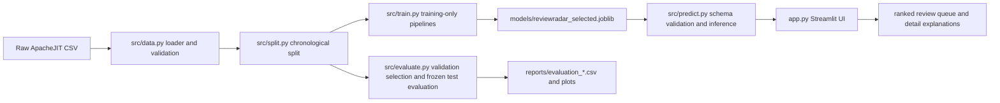
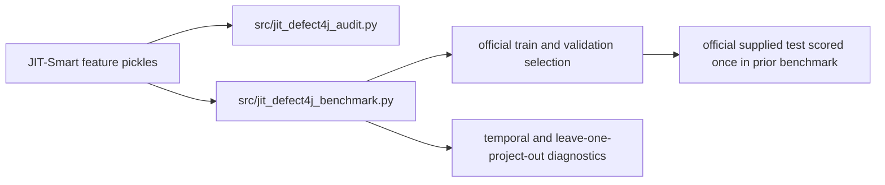

# ReviewRadar Complete Project Audit

Audit scope: repository state inspected on 2026-10-28. This document reports
what the code and saved artifacts demonstrate. It does not claim production
readiness, future-period generalization, bugs prevented, or operational savings.

## Executive summary

ReviewRadar is a Streamlit demonstration for ranking historical software
changes by a machine-learning score associated with an observed defect label.
The application loads a saved scikit-learn pipeline, validates CSV inputs,
returns scores, ranks changes under a review budget, and displays historical
benchmark diagnostics.

The strongest verified application result is the ApacheJIT Random Forest on the
frozen chronological 2018–2019 test period: F1 0.4529 and average precision
0.4138 at the validation-selected threshold 0.440246. This is a historical
benchmark result. ApacheJIT validation prevalence is 26.56%, while test
prevalence is 15.41%, which is a major distribution change.

The independent JIT-Defect4J benchmark uses a different Java commit dataset.
Its supplied test split is timestamp-overlapping, so it is not future-period
evidence. HistGradientBoosting was selected within that benchmark by
validation average precision, but leave-one-project-out diagnostics favored
Logistic Regression by mean F1. The datasets must remain separate.

The new feature-signal experiment found, across two latest development folds,
that project-as-of normalization improved ApacheJIT mean average precision to
0.6870 for Random Forest versus 0.6268 for the registered all-feature Random
Forest baseline. This is a development observation only. The same family did
not improve JIT-Defect4J Random Forest over its all-feature baseline. The
experiment does not justify changing the saved model before a genuinely later
holdout is collected.

## Problem and intended users

The intended user is a software engineer or reviewer who wants to prioritize a
limited review queue among historical or incoming changes. The system ranks
changes. It does not prove that a change is buggy, replace code review, or
estimate cost savings.

## Current product capabilities

Implemented and verified:

- CSV upload with input-schema validation.
- Sample-data mode using schema-compatible examples.
- Saved-pipeline inference through `src/predict.py`.
- Positive-class score and threshold-based risk category.
- Ranking by score and configurable review budget.
- Detail view using available change metrics and model explanations.
- Model-performance page populated from saved evaluation reports.
- Historical Demo Lab cases tied to the saved ApacheJIT pipeline.
- Error handling for missing, extra, empty, and invalid input columns.

Implemented but limited:

- The score is presented as a model score, not a calibrated production risk
  probability.
- The UI does not connect to GitHub pull requests, CI, issue trackers, or a
  live repository.
- Explainability is model-behavior context, not causal attribution.

Blocked or not implemented:

- A genuinely later independent holdout for the preregistered rolling-origin
  protocol is unavailable.
- Project-aware normalization is an experiment, not the saved production/demo
  artifact.
- No prospective intervention study measures review quality or engineering
  outcomes.

## Architecture and data flow



The independent JIT-Defect4J workflow is separate:



## Repository and module inventory

| Area | Files | Responsibility |
|---|---|---|
| Data | `src/data.py` | Load and validate ApacheJIT structure, labels, IDs, dates |
| Splits | `src/split.py` | Chronological train, validation, and test construction |
| Pipelines | `src/pipeline.py` | Training-only imputation and optional scaling |
| Training | `src/train.py` | Dummy, Logistic Regression, Random Forest comparison and saved pipeline |
| Evaluation | `src/evaluate.py` | Threshold selection, classification, calibration, PR and review budgets |
| Inference | `src/predict.py` | Saved artifact loading, input validation, scores, explanations |
| Review budget | `src/review_budget.py` | Stable score ranking, random baseline, heuristic comparison |
| UI | `app.py` | Streamlit prediction, prioritization, performance and demo pages |
| Audits | `src/final_audit.py`, `src/distribution_shift.py`, `src/project_diagnosis.py` | Validation-only shift, error, and project diagnostics |
| Independent benchmark | `src/jit_defect4j_*.py` | Separate JIT-Defect4J audit and benchmark |
| Future readiness | `src/rolling_origin_evaluation.py` | Guarded later-period readiness and reusable rolling folds |
| Signal experiment | `src/feature_signal_audit.py` | Baselines, feature families, and as-of project normalization |

## Dataset provenance and labels

### ApacheJIT

Source: ApacheJIT repository recorded in `data/external/dataset_registry.csv`.
The local main file is `data/raw/apachejit_total.csv`, with 106,674 rows and
18 columns. Each row is a software commit/change revision. The positive class
is `buggy=True`, described in local provenance reports as SZZ-derived. The
repository metadata did not provide clear redistribution terms, so licensing
must be confirmed before publishing raw data or derived artifacts.

The permitted model features are `la`, `ld`, `nf`, `nd`, `ns`, `ent`, `ndev`,
`age`, `nuc`, `aexp`, `arexp`, and `asexp`. `commit_id`, `project`, `fix`,
`year`, `author_date`, and `buggy` are excluded from the default predictor
matrix. `author_date` is used for chronology only.

### JIT-Defect4J via JIT-Smart

The local commit-level feature tables contain 25 columns and 21 projects.
Rows use `commit_hash` and the positive class is `is_buggy_commit == 1`.
The model features are `la`, `ld`, `nf`, `ns`, `nd`, `entropy`, `ndev`, `lt`,
`nuc`, `age`, `exp`, `rexp`, and `sexp`. Project, identities, messages, path
lists, `classification`, `fix`, timestamps, and the target are excluded.
The supplied train/valid/test commit IDs are disjoint, but timestamp ranges
overlap. The supplied test is therefore a held-out benchmark split rather
than a future-period holdout. License terms and complete independent label
traceability were not explicit in the inspected artifacts.

### Other datasets

ReDef is a separate function-level C/C++ modification benchmark with
revert-anchored labels. PROMISE/BPD is a release/class-level collection. They
are not merged with either commit-level benchmark.

## Training, inference, and leakage controls

ApacheJIT uses `author_date` chronological intervals: train before 2017,
validation during 2017, and test from 2018 onward. The saved Random Forest is
selected using validation average precision. The operating threshold is chosen
on validation by maximum F1 and the final pipeline is refit on train plus
validation before one frozen test evaluation.

The preprocessing pipeline uses median imputation and, for Logistic
Regression, standard scaling. These transformers are fitted inside a
scikit-learn pipeline on training data only. Identifiers, project names,
target labels, dates, and unresolved post-hoc fields are excluded.

The JIT-Defect4J benchmark follows its supplied train/valid/test protocol for
the separate benchmark. Temporal diagnostics use earlier training rows only;
leave-one-project-out diagnostics use train plus validation and a fixed
threshold. No new audit in this report uses the supplied JIT-Defect4J test.

## Measured benchmark results

### ApacheJIT saved model

| Split | Rows | Positive prevalence | Precision | Recall | F1 | Average precision |
|---|---:|---:|---:|---:|---:|---:|
| Validation, threshold 0.440246 | 10,525 | 26.56% | 0.5327 | 0.6902 | 0.6013 | 0.6233 |
| Frozen test, same threshold | 19,317 | 15.41% | 0.3430 | 0.6664 | 0.4529 | 0.4138 |

The frozen test confusion matrix is TN 12,539, FP 3,801, FN 993, TP 1,984.

### JIT-Defect4J supplied benchmark

| Model | Validation F1 | Validation AP | Supplied-test F1 | Supplied-test AP |
|---|---:|---:|---:|---:|
| Dummy prior | 0.1575 | 0.0855 | 0.1595 | 0.0867 |
| Logistic Regression | 0.3286 | 0.2564 | 0.2329 | 0.1831 |
| Random Forest | 0.3366 | 0.2651 | 0.2516 | 0.1865 |
| HistGradientBoosting | 0.3425 | 0.2789 | 0.2575 | 0.2040 |

These rows are not directly comparable with ApacheJIT because the datasets,
labels, projects, schemas, and split semantics differ.

## Temporal and project generalization

ApacheJIT contains the same 15 projects across the chronological intervals,
so its result addresses future changes within represented projects. It does
not measure unseen-project performance.

For JIT-Defect4J leave-one-project-out diagnostics, mean F1 was Logistic
Regression 0.2559, Random Forest 0.0946, HistGradientBoosting 0.0596, and
Dummy 0.0000 across 21 project folds. This ranking differs from the supplied
validation ranking and shows that model choice is deployment-setting
dependent. Project folds are correlated and some project-level estimates are
small or have limited positive labels.

## Feature-signal experiment

The new experiment uses ApacheJIT rolling folds 2016 and 2017, and
JIT-Defect4J train-only folds 2014 and 2015. It reports full fold and project
rows in `reports/feature_ablation_results.csv`.

| Dataset and family | Model | Mean AP | Mean F1 | Mean Precision@10% | Mean Recall@10% |
|---|---|---:|---:|---:|---:|
| ApacheJIT all permitted | Random Forest | 0.6268 | 0.6096 | 0.7483 | 0.2705 |
| ApacheJIT project normalized | Random Forest | 0.6870 | 0.6433 | 0.8176 | 0.2955 |
| ApacheJIT all permitted | HistGradientBoosting | 0.6303 | 0.6117 | 0.7427 | 0.2686 |
| JIT-Defect4J all permitted | Random Forest | 0.3003 | 0.2174 | 0.1029 | 0.2692 |
| JIT-Defect4J project normalized | Random Forest | 0.1811 | 0.1395 | 0.0882 | 0.2308 |

All requested feature families are available in the inspected schemas. The
data does not provide file identifiers or an independently auditable historical
file-defect join, so file-level history was not invented. The project
normalization family is computable as-of using existing project, timestamp,
and numeric metrics, but it remains an experimental feature transformation.

## Review prioritization and calibration

ApacheJIT validation top-10% Random Forest precision was 0.7407 and recall
0.2791. JIT-Defect4J validation top-10% HistGradientBoosting precision was
0.3108 and recall 0.3640. These are benchmark outcomes on different datasets.
Random selection is a simulation baseline. They do not measure review hours,
money, or defects prevented.

ApacheJIT validation Brier score was 0.1566 and ECE 0.0961. The held-out test
ECE was 0.1756. The UI should therefore treat the saved output primarily as a
ranking score, not as a calibrated probability. No calibration layer is saved.

## Software engineering audit

The code is modular, uses readable scikit-learn pipelines, and has explicit
input validation. The test suite exercises data contracts, split separation,
preprocessing behavior, inference failures, review-budget calculations, demo
cases, benchmark metrics, provenance audits, and the new feature-signal
helpers. The current complete suite result is 56 passed after the feature
experiment and audit additions.

The main engineering risks are runtime cost of repeated forest experiments,
large ignored local datasets, unclear external redistribution rights, and the
absence of a clean-environment reproduction test that downloads or validates
all data artifacts from scratch.

## Product utility and limits

The current product is useful as an educational and research demonstrator for
ranking historical changes under a stated review budget. It can show which
uploaded changes receive higher model scores and why the model assigns those
scores. A real GitHub workflow would require an authenticated integration,
change-metric extraction at pull-request time, asynchronous scoring, audit
logging, repository-specific monitoring, and prospective human-outcome
evaluation. None of those capabilities should be claimed today.

## Prioritized improvements

1. Collect a genuinely later labeled period and reserve it before model
   selection.
2. Repeat the feature-signal experiment across more than two development
   periods and inspect project-level stability.
3. Resolve dataset licenses and label provenance before redistribution.
4. Measure calibration on a deployment-representative development protocol.
5. Add a clean-environment, artifact-checksum reproduction path.
6. Conduct a prospective review study before claiming product utility.

## Exact reproduction commands

```powershell
.\.venv\Scripts\python.exe -m src.feature_signal_audit
.\.venv\Scripts\python.exe -m src.generalization_audit
.\.venv\Scripts\python.exe -m src.jit_defect4j_audit
.\.venv\Scripts\python.exe -m src.jit_defect4j_benchmark
.\.venv\Scripts\python.exe -m pytest -q
.\.venv\Scripts\python.exe -m streamlit run app.py
```

The feature and JIT commands are resource-intensive. The feature experiment
uses only development folds and does not overwrite frozen benchmark reports.

## References inside the repository

`src/data.py`, `src/split.py`, `src/pipeline.py`, `src/train.py`,
`src/evaluate.py`, `src/predict.py`, `src/review_budget.py`, `app.py`,
`src/jit_defect4j_benchmark.py`, `src/rolling_origin_evaluation.py`,
`reports/evaluation_protocol.md`, `reports/final_readiness.md`,
`reports/jit_defect4j_evaluation_protocol.md`,
`reports/generalization_audit.md`, `reports/feature_signal_audit.md`, and
`data/external/dataset_registry.csv`.
